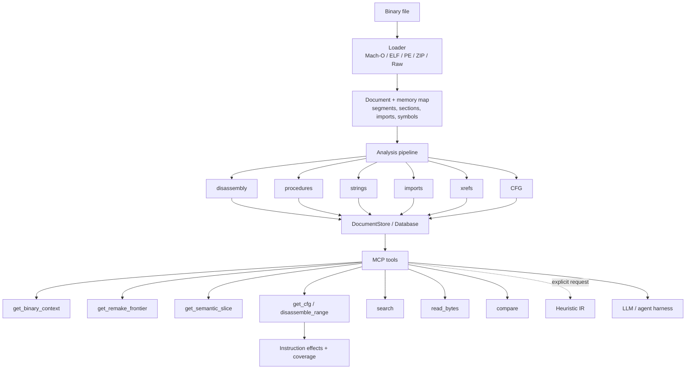

# Phora

[](LICENSE)
[](https://ziglang.org/)
[](https://modelcontextprotocol.io/)
[](#known-limitations)

Phora is an MCP-native binary analysis engine for agentic reverse engineering. It loads binaries, builds memory maps, extracts procedures, strings, imports, xrefs, and control-flow evidence, then exposes that evidence through bounded tool calls designed for LLM workflows. Instead of dumping an entire binary into context, Phora helps agents plan, divide, inspect, prove, and resume analysis.

This is an early public source snapshot. It is useful for review, experimentation, and MCP integration work, but it is not a polished public release yet.

Phora is released under CC0 1.0 Universal. No rights are reserved. You may copy, modify, distribute, and use it for any purpose, including commercial use, without asking permission.

## Why Phora

Phora is built around the idea that binary analysis should be split across agents instead of forced through one linear tool session. A harness can load one binary, compare several versions, or inspect many binaries at once, then fan out focused MCP calls across functions, imports, strings, raw bytes, and subsystem slices.

The important design choice is that Phora returns bounded, structured evidence. Tool results are JSON-shaped for MCP clients, and the higher-level tools are designed to produce useful next calls instead of dumping everything into one enormous response. That makes it practical for multiple agents to divide the work: one maps the binary, one follows call graph evidence, one checks strings and imports, one compares versions, and another drops to bytes or disassembly when the model needs proof.

Phora can also stay small. The release build is configured for a 2 MiB binary budget, while the dev-only benchmark lane checks JSON validity, core MCP behavior, strict self-analysis, and repeatable two-agent runs.

The analysis path is evidence-first: mapped bytes, instructions, control flow, references, and symbols. Phora does not generate pseudocode and has no `decompile` tool. The LLM reasons from structured evidence. Heuristic IR remains available through an explicit `lift` request, separately labeled from encoding-backed instruction effects.

## Architecture



## Build

The [latest packaged release](https://github.com/dammonburden/phora/releases/latest) provides a macOS ARM64 executable and SHA-256 checksums. See the release notes for the tested platform and build details.

Source builds currently use macOS host tools (`strip` and `stat`). Requires Zig 0.17.0.

```sh
zig build
```

The release build is configured for a 2 MiB binary budget.

## Test

```sh
zig build test
zig build check-safe
zig build verify
```

Some integration tests inspect host-system binaries and may skip when expected local files are unavailable.

## Benchmark Harness

The dev-only MCP benchmark harness uses only the Python standard library and talks to Phora through `phora serve --stdio`.

```sh
python3 scripts/bench-phora.py --dry-run
python3 scripts/bench-phora.py --phora ./zig-out/bin/phora
python3 scripts/bench-phora.py --phora ./zig-out/bin/phora --case system-ls-auto-context --two-agent
```

Cases live in `benchmarks/cases.json`. Each case resolves the first available local target, skips cleanly when all target candidates are missing, records JSON validity, latency, MCP/tool errors, and scores expected clues in the returned analysis text.

Run reports are written by default under `benchmark-results/`, which is ignored and should remain untracked.

## MCP

Build Phora, then configure an MCP client with the stdio server:

```json
{
  "mcpServers": {
    "phora": {
      "command": "/absolute/path/to/phora/zig-out/bin/phora",
      "args": ["serve", "--stdio"]
    }
  }
}
```

Use `.mcp.example.json` as a template. Do not commit local `.mcp.json` files with machine-specific paths.

### MCP Tool Highlights

These are the tools that make Phora useful as an app/MCP combo for agentic analysis:

| Tool | Why it matters |
| --- | --- |
| `load_binary` | Loads one or more local binaries into Phora and returns the document IDs, detected format, architecture, entry point, and summary stats. |
| `get_binary_context` | First call after loading. It chooses a compact full view, a frontier plan, or a lightweight manifest based on binary size and shape. |
| `get_remake_frontier` | Ranks the next functions or subsystems to inspect and emits `parallel_batches` that a harness can hand to multiple agents. |
| `get_semantic_slice` | Compiles a function or cluster into LLM-ready facts, context packs, or structured remake/spec evidence. |
| `get_cfg` + `disassemble_range` | Exposes control-flow blocks and bounded instructions, with exact bytes, file offsets, and explicit instruction-semantics coverage. |
| `read_bytes` | Primary raw-byte evidence by mapped address or file offset, with exact hex, optional numeric views, and bounded continuation. |
| `search` | Searches names, strings, imports, calls, string references, capability markers, and static writers across one or all loaded documents. |
| `compare` | Diffs two loaded binaries by imports, strings, libraries, and optional procedure fingerprints for version-to-version analysis. |
| `suggest_names` + `annotate` | Supports the iterative workflow: gather naming evidence, apply names/comments/tags, then re-run context with better labels. |
| `save_project` + `load_project` | Persists analysis state so a later session can resume without re-running the whole load/analyze path. |
| `lift` | Optional heuristic IR, explicitly marked `verification_required`. It is not validated instruction semantics and has no output-format selector. |

### Reasoning directly from bytes

Raw bytes are primary evidence, even when a decoder or lifter cannot explain them. An LLM can recognize headers, strings, numeric tables, record layouts, instruction encodings, and small function behavior directly. Keep observed bytes separate from a proposed interpretation and verify the interpretation before relying on it.

Start with a bounded `read_bytes` range (often 64–512 bytes). Use `file_offset` for exact file coordinates or `address` for a mapped virtual range; provide exactly one. Preserve architecture, calling convention, instruction boundaries, base address, and endianness when known. `document_architecture` comes from the loaded document or caller configuration; a data chunk may describe another architecture. Raw bytes alone do not establish a function signature or original source names.

```text
read_bytes doc_id=1 file_offset=0 length=128 encoding=hex_compact
read_bytes doc_id=1 address="0x..." length=64 element_size=4 byte_order=little
```

Hex preserves byte identity. ASCII is a lossy preview: dots replace nonprintable bytes. Numeric views preserve exact integer values but do not establish their meaning. For machine code, check widths, signedness, flags, register overwrites, extension modes, and branch targets; use `disassemble_range` as another piece of evidence and test reconstructed behavior when possible. A plausible algorithm is not enough.

Reads report requested and returned lengths, backing (`file` or `zero_fill`), and stop reason. Virtual reads stop at mapping/backing boundaries; zero-fill bytes are synthesized and have no file offset. Follow `next_call` for encoding-budget pages. At a boundary or EOF, the result explicitly reports a short read instead of substituting unrelated file bytes.

`get_binary_context mode=full include_bytes=true` adds bounded section previews: up to 4 KiB per section and 16 KiB overall, reduced by the response budget. `compact_hex_with_zero_runs` uses `[ZERO*N]` to represent N actual zeros; this does not classify them as padding. Section lengths, returned lengths, and continuations identify omitted bytes. Use `read_bytes` for ordinary exact hex and follow its pages for larger ranges.

### Reconstructing loops

Read every required `get_cfg` instruction page before proposing a loop. ARM64 offers `instruction_view="execution"`; other architectures and the legacy view use `include_disassembly=true`. `loop_evidence` derives natural loops from the full recovered graph (up to 512 blocks and 4096 edges); each page reports loops intersecting its visible blocks. Headers, latches, repeated instruction ranges, and exits remain in one address space when rebased. `entry_edges` identify recovered entries from outside each loop, distinguishing one-time setup from repeated header instructions. `parent_header` identifies the smallest strict containing natural loop; ambiguous overlapping containers produce a null parent and an explicit status. Separate totals and truncation flags identify omitted summaries, members, or entries. Graph or response budget omissions are explicit, not evidence of no loops. Dominance is relative to recovered edges; unresolved branches and irreducible cycles still limit conclusions.

Full `get_binary_context` automatically includes `control_flow_evidence` for a single procedure with a known extent and total executable bytes both at most 512. Original-address ARM64 contexts use compact execution steps; other architectures retain the disassembly/provenance view. Automatic selection requires procedure metadata. For rebased documents, use explicit CFG and disassembly calls; a rebased CFG may provide adjacency plus an instruction continuation. The early field supplies an exact `get_cfg` continuation when the context budget cannot fit the graph. `executable_coverage` reports bytes outside the recovered CFG and provides disassembly continuations; a complete page does not establish complete control-flow recovery.

`get_cfg instruction_view="execution"` emits ARM64 instruction addresses, raw bytes, assembly, and local register equations in each block. `@in_<block-address>` identifies that block’s incoming state on the current visit, including backedges. These symbols have distinct block scopes; they do not denote the function’s initial arguments. Address-qualified writes distinguish values before and after a step; right-hand sides are read before any write. W writes clear the upper X bits, arithmetic wraps at the encoded width, and flag expressions retain their actual inputs. Follow CFG edges rather than sorting instructions into a high-level recurrence.

Execution text also supplies predecessor-specific incoming bindings: `via 0xA = zext32(w2@0xWRITE)` links the current block input to an actual earlier write. A backedge supplies the most recent traversal’s value. Direct MOVZ/MOVN producers include literal annotations. Joins retain alternatives; unknown instructions, calls, missing bytes and revisited no-write paths remain unresolved. This is bounded reaching-write evidence, not algebraic substitution or a recurrence proof. Derivation covers at most 512 blocks, 4096 edges and 4096 instructions; a response processes at most 128 bindings and 262144 search steps. Each binding considers at most 16 predecessors and 16 distinct writers. Per-block text is capped at 8192 characters with explicit omissions and a legacy provenance continuation. `incoming_state_evidence` reports work and limits. `loop_context` lists containing natural-loop headers for each visible block using the full graph, including headers on other pages.

The context’s `instructions_at` field points to the instruction evidence. In execution mode, read each block’s `execution.text`; absence of a legacy `instructions` array does not mean missing code. The `reconstruction_workflow` recommends a block-by-block reference before simplification: retain every assignment and branch destination, trace changed carried values through at least two visits, and check exits before choosing `break` or `continue`. An opaque effect still has its bytes and displayed assembly.

The optional local modular composition combines supported additions, subtractions, constant left shifts and safe copies within the covered block. It coalesces coefficients modulo the encoded width, retaining unsolved register-write atoms for other effects. A wrapped 32-bit value read as 64 bits remains an indivisible zero-extended value; the summary does not distribute that conversion through earlier arithmetic. Bounds are eight terms per form, 128 composed operations and eight reported outputs. Fallback and output-omission counts are explicit when summaries are emitted, and summaries are omitted when the instruction-step budget leaves a tail. These are local identities, not inferred cross-block recurrences or invariants.

This view models a finite scalar subset: ordinary arithmetic, shifted logical operations, move-wide values, selected bitfield operations, multiply-add/subtract, CSEL, ordinary scalar immediate memory operations, GPR 32/64-bit LDP/STP offset/pre-index/post-index operations, and direct branches. Paired operations show both memory accesses and the base writeback using values from before the instruction. Unsupported LDPSW, SIMD, non-temporal/reserved pair forms and constrained-unpredictable overlaps remain opaque. Memory equations describe normal completion; ordering, atomicity and fault behavior are not modeled. Unsupported instructions remain visible with assembly and bytes, invalidate local GPR/SP/flag provenance, and leave effects, memory, control flow and subsequent reachability unknown. Equations assume normal completion of reached instructions; they are not cross-block SSA or a complete decompiler. Calls, SIMD and atomics currently remain opaque here.

The default `get_cfg` format is unchanged. `detailed_provenance_call` returns the legacy ARM64 disassembly/reaching-write view. Execution pages retain `instruction_view` in `next_call`; per-block limits and response limits expose omitted byte ranges with exact disassembly and raw-byte follow-ups. Execution currently requires an original-address ARM64 document; rebased or other-architecture requests return guidance to use the legacy view.

The legacy ARM64 `get_cfg` view also returns `register_flow_evidence`: encoding-backed reads before a block's first register write, with separate reaching-write addresses for each predecessor. Use these addresses to distinguish entry initializers from values updated by a loop traversal or another branch. W/X views share storage; register 31 denotes SP only where the instruction encoding permits SP, and ZR contributes no storage. Searches derive from the full recovered graph even when the response shows one page. Unknown instructions, calls, missing bytes, revisited paths, and explicit graph/search/output limits produce conservative unknown or truncation evidence. This is partial GPR provenance, not full SSA, value recovery, flag analysis, or a proof that all execution paths were recovered.

Place loader overrides inside `options`, for example `load_binary {"path":"code.bin","options":{"arch":"arm64","base":4096,"entry":4096}}`. Top-level `arch`, `base`, `entry`, `fat_arch`, `analysis`, or `budget_ms` are rejected with an actionable diagnostic; unsupported architecture names and invalid numeric overrides are rejected before loading.

On a taken back edge, execution restarts at the header, including its first instruction. Keep header arithmetic and inner-loop initialization at their actual nesting level unless invariance is separately proved. Trace zero, one, and two iterations, recording register values, pointer updates, widths, and the next address. Check nested and early-exit paths independently; a correct-looking recurrence is still a hypothesis until compared against known behavior.

Supported ARM64 scalar pre/post-indexed loads and stores expose separate `addressing_evidence` in CFG instructions and disassembly. It distinguishes the memory address from the arithmetic update of the base register. For example, `ldr x1, [x19, #40]!` advances x19 by 40 and loads x1 from that address; it does not load a new x19 from memory. This evidence covers addressing on normal completion only and does not change the full instruction's semantic-coverage status.

Supported ARM64 ADD/SUB shifted-register encodings also expose `arithmetic_evidence`: source and destination registers, arithmetic width, shift, flag writes, and the rule to read both sources before updating the destination. Read a loop-assigned register's current carried value on each traversal. Its initializer is not a constant substitute inside the loop. This evidence describes the arithmetic family only; full instruction semantic coverage remains separate.

ARM64 non-wrapping SBFM/UBFM extraction rows include `bitfield_evidence`: source field, signed versus zero extension, W/X width, and write ordering. Signed one-bit extraction produces a zero or all-ones mask within the destination width. Other bitfield forms remain unmodeled by this helper.

Adjacent ARM64 SUBS/CMP and B.cond pairs expose `branch_predicate_evidence` in CFG and disassembly, with a concise equivalent in context packs. Predicates refer to input values before subtraction. For example, `subs x2, x2, #64; b.hi` continues when unsigned x2 before subtraction exceeds 64; testing the wrapped updated x2 alone loses the carry/no-borrow condition. Immediate and valid shifted-register subtraction are supported. CFG evidence never crosses a block entry; linear evidence is explicitly conditional on consecutive execution, and intervening instructions are not skipped.

### Instruction Semantics

`disassemble_range` attaches `semantics` to every returned instruction. The first modeled family is ARM64 `MOVZ`, `MOVN`, and `MOVK`, decoded from encoding bits rather than mnemonic aliases. It reports operand width, immediate, shift, destination register, and a 64-bit register transfer. W-register writes clear the upper half of the backing X register. Register 31 is the zero register, never the stack pointer; its writes are discarded.

For a GPR destination, `transfer.op=masked_insert` means `new_X = (old_X & preserve_mask) | value_bits`. Masks and values are fixed-width hex strings to avoid JSON-number precision loss. These effects describe normal execution, not instruction-fetch faults or debug traps. They include flag, memory, and control-flow effects for this family only.

Other instructions and architectures report `status=unsupported`, not a no-op. This status describes formal effect coverage; it does not mean disassembly failed. Reserved encodings within the modeled family report `invalid_encoding`. `semantics_summary` counts coverage; `partial`, `stop_reason`, and `next_address` identify incomplete ranges. This is a narrow, tested foundation, not a complete ISA model or proof of whole-function behavior.

ARM64 decoder family labels such as `simd/fp` and `simd/ldst` are explicitly unsupported instruction identities. Disassembly preserves their four-byte raw slots and reports `decode_status`, `decode_gaps`, and `decode_summary`. CFG recovery stops that path with an `unknown` terminator; `unknown_terminator_blocks` exposes these barriers, including decoded traps. Supported vector and pointer-authentication identities may still lack formal effect semantics.

Context packs prioritize requested seed functions over cluster neighbors. `instruction_coverage` distinguishes inspected `covered_bytes` from `decoded_bytes`, `decode_gaps`, and `decode_complete`, and supplies a structured `next_call` for omitted evidence. Validated Mach-O linker entries are preferred over prologue and post-return heuristics, including in universal binaries. ARM64 post-return guesses also preserve direct branch targets inside existing sized named symbol ranges. `boundary_kind=linker_start_next_boundary` means the extent runs to the next entry or code-section end; padding and split code can remain. Other bounds are inferred. Complete byte coverage does not establish source equivalence.

`lift` accepts `offset` and `max_results` (default 128, maximum 256). Each result pages through statements followed by variable records; follow its `next_call` until `partial=false`. Embedded IR in `analyze_functions` uses the same continuation. `opaque` statements preserve unsupported instruction mnemonics and operands and stop value propagation; they are unknown effects, not no-ops. `block_start` marks a control-flow join or block boundary. Lifted register names preserve physical architecture views; they do not assign SysV roles to Windows registers. Return values are architecture-specific candidates, and calls with unknown arguments remain explicit. Writes to ARM64 W registers replace the corresponding X register with a zero-extended 32-bit value; aliases are not independent variables. IR still requires instruction-level verification.

`get_cfg` reduces page size to retain inline instructions, with a compact fallback for an oversized individual block. Its `partial` field describes pagination only. `unresolved_indirect_jumps` identifies branches whose destinations were not recovered; a finished page sequence is not proof of a complete control-flow graph. ARM64 recovery now follows validated relative byte/halfword jump tables with a proven unsigned guard or contiguous low-bit index mask, readonly mapped storage, and aligned destinations inside the function. `recovered_indirect_jumps` counts branches connected by this recovery. Recovery is refused when reachable indirect flow remains unvalidated. Unsupported patterns remain unresolved. Large CFGs in `analyze_functions` are summaries with a `get_cfg` continuation.

Pass `include: ["abi", "types", "ir"]` to `analyze_functions` for bounded recovery evidence. `abi_evidence` reports a platform C ABI default and conservative argument-register reads before a control-flow or unsupported-instruction barrier. `first_read_width_bytes` describes that read, not a parameter type; `parameter_count` remains unknown. Lifted calls without supported argument recovery carry `arguments_status: "unknown"`; nearby register writes are not fabricated into call signatures. Go metadata and raw binaries suppress C ABI assumptions. `type_evidence` reports memory access offsets, widths, overlap, and signed/unsigned loads. Size hints are heuristic estimates (including legacy frame padding), not proven object extents. These are layout hypotheses: indexed accesses are excluded, and reused register names can refer to different objects. Follow the supplied `lift` continuation for full instruction evidence.

ARM64 decoding distinguishes SIMD memory widths (including 16-byte Q accesses), selected vector integer/bitwise operations, BCAX, and EOR3. Vector arithmetic remains opaque in the heuristic IR, preserving decoded operands and stopping unsafe value propagation. Correct disassembly does not imply complete vector semantics or a recovered vector type. IR memory operations expose `memory_width_bytes` and `load_extension` when supported.

`read_bytes` can interpret numeric tables with explicit `element_size` (1, 2, 4, or 8 bytes) and `byte_order` (`little` or `big`). Reads of at most 256 elements return exact unsigned decimal strings, preserving full 64-bit precision and exceptional table entries. Trailing bytes remain uninterpreted; the raw bytes are still included.

Both x86 modes have bounded disassembly and CFG support. For x86, `udf`, `db`, and `unsupported` decoder fallbacks are opaque evidence gaps, not proof of an undefined CPU operation; `disassemble_range` marks them with `decode_status` and counts `decode_gaps`. Address16 decoding and 32-bit x86 lifting remain unsupported.

Thumb disassembly tracks IT predicates within the requested range and distinguishes unknown encodings from actual UDF. Start at a function entry to include preceding IT state. Conditional returns retain their untaken CFG path. `get_cfg` paginates blocks with `offset`, `max_blocks`, and a structured `next_call`; outgoing edges can point outside the current page. Large inline instruction lists fall back to compact graph data with a separate disassembly follow-up. CFG blocks end at decoded terminators and keep external branch destinations, but indirect targets and inferred procedure boundaries still require verification.


A typical swarm-style harness loop looks like this:

```text
load_binary path=/path/to/binary
get_binary_context doc_id=1 mode=auto
get_remake_frontier doc_id=1 goal="understand the update path"

# Fan out calls from parallel_batches:
get_semantic_slice doc_id=1 addresses=["0x..."] view=pack scope=cluster
get_cfg doc_id=1 function_address="0x..." include_disassembly=true
search doc_id=1 type=string_refs pattern="update|config|token"
read_bytes doc_id=1 address="0x..." length=256
```

## Known Limitations

- Phora is a public preview, not a polished release.
- Stdio is the recommended MCP transport.
- HTTP remains experimental until the request-arena leak is resolved.
- `read_bytes` returns bounded hex/ascii evidence from mapped addresses, not arbitrary memory.
- Heuristic IR can omit or misrepresent behavior, types, and calling conventions. In `disassemble_range`, use encoding-backed effects only where their status is `modeled`; that view currently models ARM64 move-wide instructions. The separate ARM64 CFG execution view covers the finite subset described above and explicitly marks unsupported effects opaque.
- Benchmark results are sanity checks, not formal performance claims.
- Analysis depth varies by architecture, format, strippedness, and binary size.
- Integration tests and benchmarks may skip host-specific binaries.

## License

Phora is dedicated to the public domain under [CC0 1.0 Universal](LICENSE). Where a public-domain dedication is not fully recognized, CC0 provides a broad fallback license.

## Known-Answer Benchmarks

The dev-only benchmark lane exercises Phora through MCP against local binaries and skips cases whose targets are missing:

```sh
scripts/bench-phora.py --dry-run
scripts/bench-phora.py --case phora-self-context
scripts/bench-phora.py --two-agent --case phora-self-context --case system-ls-auto-context
```

Benchmark results are written under `benchmark-results/` and are intentionally ignored.

## Safe Source Export

This working directory contains local reports, generated artifacts, and binary samples that should not be pushed. Use the guarded export path instead:

```sh
scripts/github-safe-publish.sh
```

The default mode creates a sanitized source-only export repository and does not push. Pushing requires an explicit remote, `--push`, and an explicit visibility confirmation flag: `--confirm-public-repo` or `--confirm-private-repo`.

Export tests reuse a persistent Zig global cache while keeping each export's local cache and install prefix temporary. Set `PHORA_EXPORT_ZIG_CACHE_DIR` to choose that cache; otherwise the script honors `ZIG_GLOBAL_CACHE_DIR`, then uses `phora/zig-export` under `XDG_CACHE_HOME`, `~/Library/Caches` on macOS, or `~/.cache` elsewhere. Relative overrides resolve from the directory where the script is invoked. The cache must be outside the source and export trees and is never copied into an export.

`ZIG` selects the compiler. Pass `--require-tests` to fail the export when Zig is unavailable or its tests fail; `zig build verify` uses this mode. Run `scripts/test-github-safe-publish.sh` to check export cache behavior and failure handling with a fake compiler, without compiling Phora or pushing anything.
